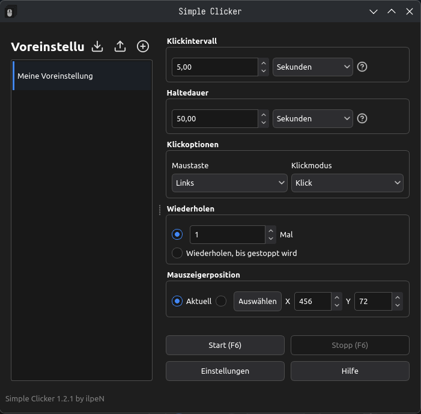
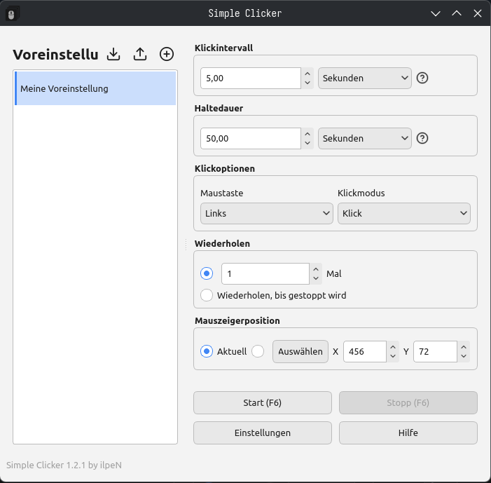

# SimpleClicker - Ein einfacher Auto-Clicker

[This document in English](./README.md)

[Bu belgenin Türkçesi var](./README.tr.md)

[Ce document en français](./README.fr.md)

- Alles wird auf deinem eigenen Rechner im Ordner `C:\Users\<your_name>\AppData\Roaming` bzw. `~/.local/share/` gespeichert
- Aufgetretene Fehler oder eigene Verbesserungsvorschläge kannst du gerne über GitHub Issues melden

## Installationsanleitung für Windows

1. Führe die heruntergeladene Datei `SimpleClicker.exe` aus.
2. Klicke auf Weiter, akzeptiere die Lizenz, klicke erneut auf Weiter und installiere die Anwendung.
3. Die Desktop-Verknüpfung wird automatisch erstellt.

## Installationsanleitung für GNU/Linux

1. Installiere `SimpleClicker-x86_64.AppImage` an einem beliebigen Ort.
2. Mache die Datei mit `chmod +x SimpleClicker-x86_64.AppImage` ausführbar.
3. Starte die Anwendung.
- HINWEIS: Damit das Programm funktioniert, müssen die erforderlichen Bibliotheken installiert und einige Systembibliotheken auf dem neuesten Stand sein.
(Fehlende Bibliotheken werden in der Ausgabe angezeigt, wenn Sie die Anwendung über die Konsole starten.)
(Da glibc >= 2.35 benötigt wird, sind Ubuntu >= 22.04, Debian >= 12, Fedora >= 35, Linux Mint >= 21 und die meisten modernen Arch-basierten Distributionen (CachyOS, Garuda Linux, SteamOS, EndeavourOS, Manjaro Linux usw.) erforderlich.)

## Hilfe
- [Hier klicken für ausführliche Hilfe](./assets/docs/HELP.de.md)

## Über

- Entwickelt von [ilpeN](https://github.com/ilpenSE).
- In C++ mit Qt entwickelt.
- Symbole: [Feather Icons](https://feathericons.com/)
- Lizenz: AGPL-3.0 only (GNU Affero General Public License)
