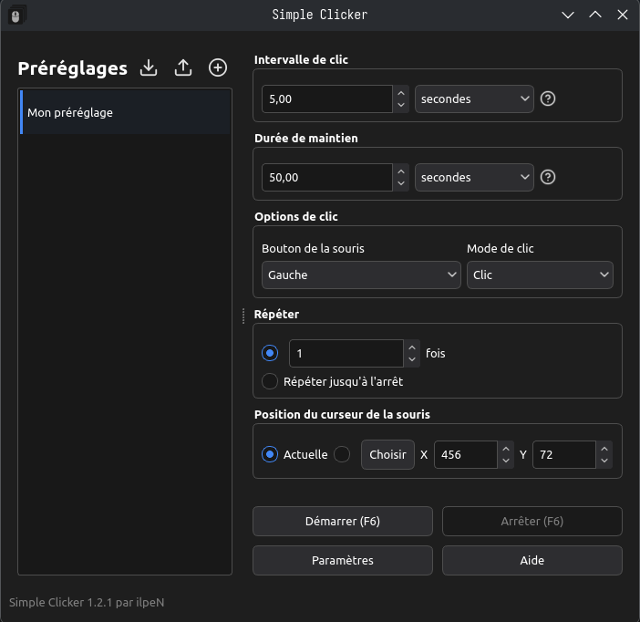
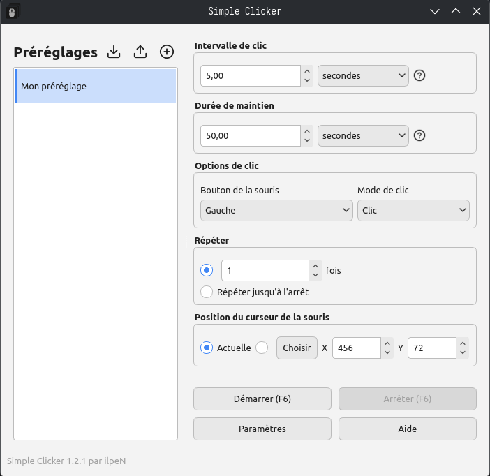

# SimpleClicker - Un auto-clicker simple

[This document in English](./README.md)

[Bu belgenin Türkçesi var](./README.tr.md)

[Dieses Dokument auf Deutsch](./README.de.md)

- Tout est stocké sur votre propre machine, dans le dossier `C:\Users\<your_name>\AppData\Roaming` ou `~/.local/share/`
- Vous pouvez signaler les erreurs rencontrées ou vos idées d'amélioration via les issues GitHub si vous le souhaitez

## Guide d'installation pour Windows

1. Exécutez le fichier `SimpleClicker.exe` que vous avez téléchargé.
2. Cliquez sur Suivant, acceptez la licence, cliquez à nouveau sur Suivant, puis installez.
3. Le raccourci sur le bureau est créé automatiquement.

## Guide d'installation pour GNU/Linux

1. Placez `SimpleClicker-x86_64.AppImage` dans le répertoire de votre choix.
2. Rendez le fichier exécutable en exécutant `chmod +x SimpleClicker-x86_64.AppImage`.
3. Lancez l’application.
- REMARQUE : Pour que le programme fonctionne, les bibliothèques nécessaires doivent être installées et certaines bibliothèques système doivent être à jour.
(Les bibliothèques manquantes devraient s'afficher dans la sortie lorsque vous lancez l'application depuis la console.)
(Comme glibc >= 2.35 est requise, Ubuntu >= 22.04, Debian >= 12, Fedora >= 35, Linux Mint >= 21 et la plupart des distributions modernes basées sur Arch (CachyOS, Garuda Linux, SteamOS, EndeavourOS, Manjaro Linux, etc.) sont nécessaires.)

## Aide
- [Cliquez ici pour l'aide détaillée](./assets/docs/HELP.fr.md)

## À propos

- Créé par [ilpeN](https://github.com/ilpenSE).
- Développé en C++ avec Qt.
- Icônes: [Feather Icons](https://feathericons.com/)
- Licence : AGPL-3.0 only (GNU Affero General Public License)
