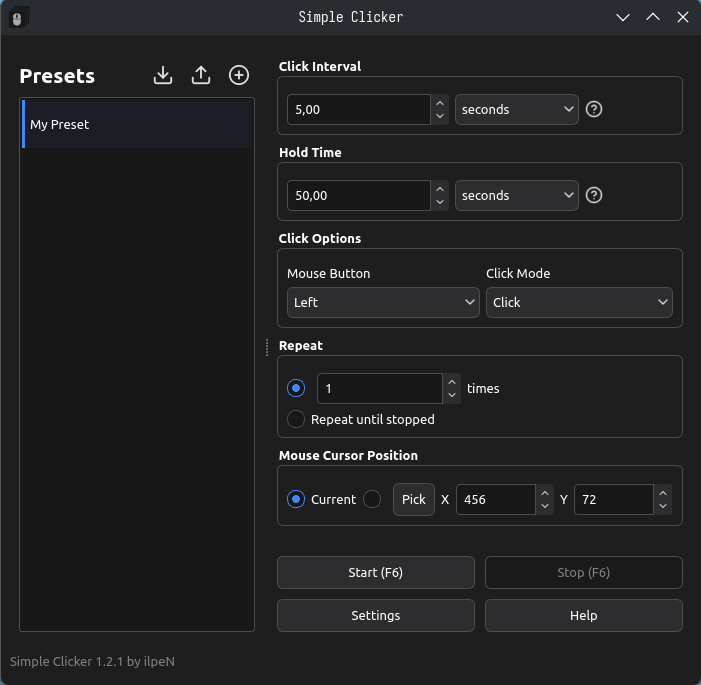
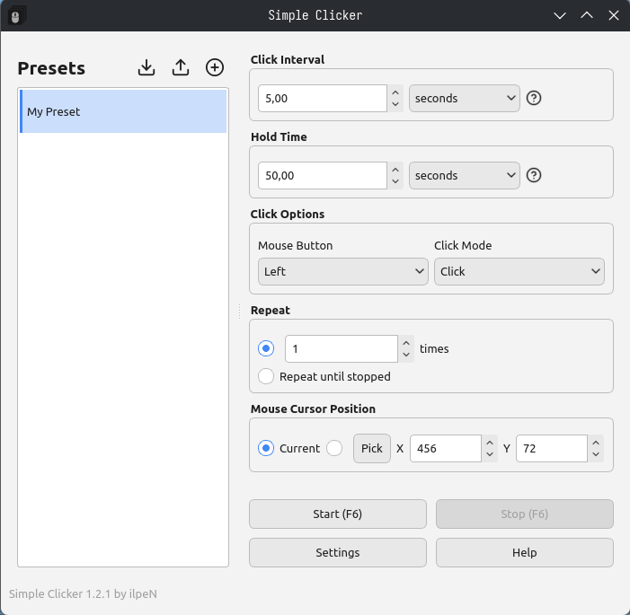

# SimpleClicker - A Simple Auto-Clicker

[Bu belgenin Türkçesi var](./README.tr.md)

[Ce document en français](./README.fr.md)

[Dieses Dokument auf Deutsch](./README.de.md)

- Everything is stored on your own machine and in `C:\Users\<your_name>\AppData\Roaming` or `~/.local/share/` folder
- You can report errors you have crossed or ideas of yours to enhance application via GitHub issues if you want

## Installation Guide for Windows

1. Run `SimpleClicker.exe` you downloaded.
2. Hit Next, accept the license, next then install it.
3. The desktop shortcut automatically created

## Installation Guide for GNU/Linux

1. Install `SimpleClicker-x86_64.AppImage` to anywhere you like.
2. Make it executable by running `chmod +x SimpleClicker-x86_64.AppImage`
3. Run it.
- NOTE: In order to program to function, necessary libraries need to be installed and some system libraries need to be up to date.
(Missing libraries should be shown at output when you run app through console)
(Ubuntu >=22.04, Debian >=12, Fedora >=35, Linux Mint >=21 and most modern Arch-based distros (CachyOS, Garuda Linux, SteamOS, EndeavourOS, Manjaro Linux vb.) is needed for glibc >= 2.35)

## Help
- [Click here for detailed help](./assets/docs/HELP.en.md)

## About

- Made by [ilpeN](https://github.com/ilpenSE).
- Developed in C++ using Qt.
- Icons: [Feather Icons](https://feathericons.com/)
- License: AGPL-3.0 only (GNU Affero General Public License)
